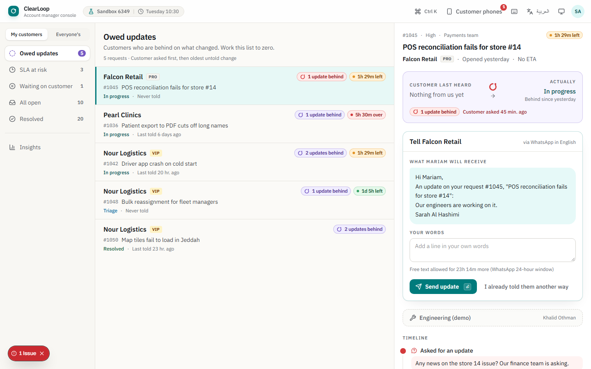
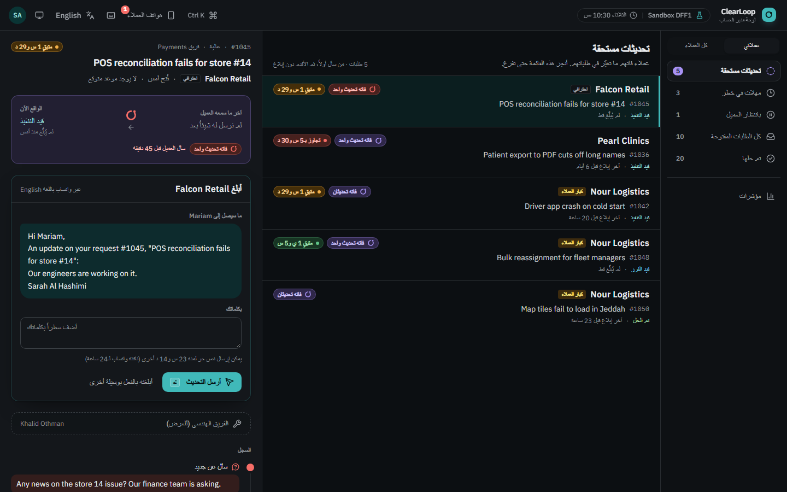
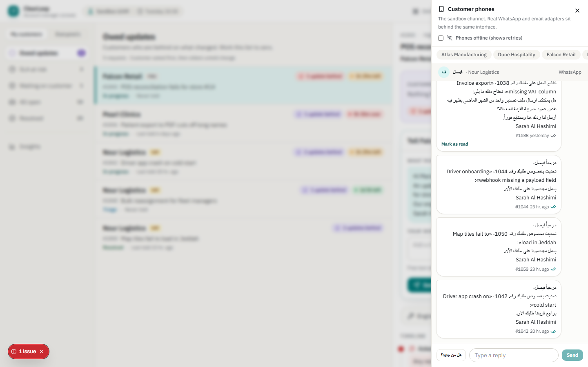
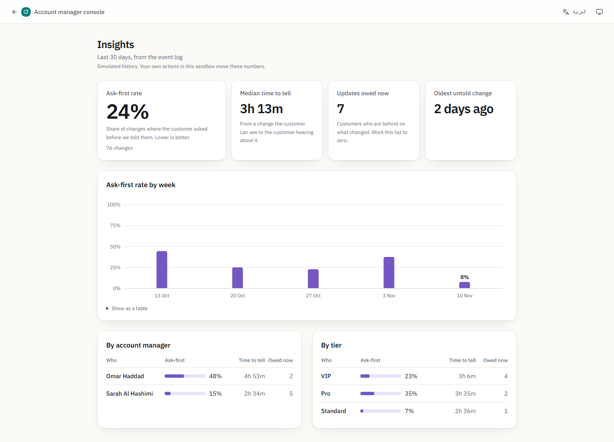
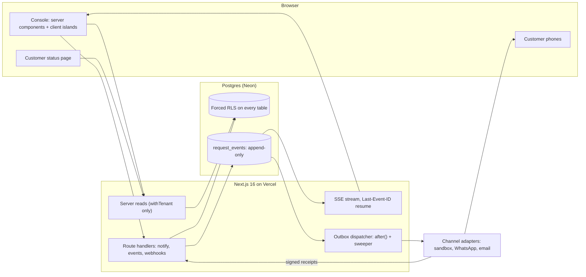

# ClearLoop

ClearLoop is a console for account managers at B2B SaaS companies in the GCC. It shows what each customer knows next to what is true, and closes the gap in one keystroke. Your customer should never have to ask "any update?"

Built by **Eslam Hamed**, Technical Lead & AI Solutions Architect.

[](https://github.com/Eslam93/clearloop/actions/workflows/ci.yml) 

**Live demo:** [clearloop-six.vercel.app](https://clearloop-six.vercel.app). You get your own sandbox tenant; no sign-up.



## Run it

```bash
pnpm install
pnpm dev
```

Then open http://localhost:3000 and click **Open the live demo**. `pnpm dev` starts a real Postgres from npm (embedded, no Docker), migrates it, and runs Next.js. No account and no API keys.

## Try this in 60 seconds

1. **Owed updates** lists customers who are behind on what changed. Nour Logistics (VIP) is two updates behind, while its SLA still has 1.5 business hours left. On time but in the dark: that is the brief's CSAT problem, made visible.
2. Select it and press `n`, then `Enter`. The message is in Arabic, because this customer prefers Arabic, and it is signed by the account manager, not a model.
3. Open **Customer phones**. The message arrived; mark it read and the receipt comes back through the same signed webhook a real provider uses.
4. In the demo controls, click **Open a second window as Omar**. In the first window, select Nour Logistics and press `n` to start an update. In the second, open the same request and move it to *Blocked* under Engineering (demo). The first window says, live, that the request changed while you were looking, and keeps your words. Send anyway and the server refuses with 409. Nothing reaches the customer until you review the new message.
5. In the time machine, jump to **Thursday 16:30**, then **After the weekend**. SLA countdowns stop for Friday and Saturday in Riyadh, and for Saturday and Sunday in Dubai.
6. Reply **"Any update?"** from a customer's phone, then open **Insights**: the ask-first rate counts what you just did.
7. Turn on **Customer status page** and copy a customer link: bilingual, no login, and no internal notes.

The full walkthrough is in [`docs/demo-script.md`](docs/demo-script.md).

| Arabic, dark | Customer phones | Insights |
|---|---|---|
|  |  |  |

## What it does

- **Update debt.** An SLA asks whether we are slow. Debt asks whether the customer knows: the customer-visible changes they have not been told about. The **Owed updates** view is that list, ranked by who asked first, then by how long they have been in the dark.
- **The ask-first rate.** The share of changes where the customer asked before we told them. v1's riskiest assumption was whether account managers would notify proactively; this measures it from the event log, continuously.
- **Business time for the GCC.** Each customer's SLA runs on their calendar: Sunday to Thursday in Saudi Arabia, Qatar, Kuwait, Bahrain, Oman and Egypt, Monday to Friday in the UAE, Ramadan hours from the Umm al-Qura calendar, and holidays as data. The clock pauses while a request waits on the customer.
- **A loop you can see close.** Delivered and read receipts, a customer phone simulator, WhatsApp's 24-hour rule (free text only within a day of the customer's last message, templates otherwise), and a customer status page behind a flag.
- **Concurrency you can watch.** Live updates over Server-Sent Events, presence, a 409 with a "what changed" explanation, and one message when two account managers click at once.
- **Arabic and English.** Everything works right to left, with typed dictionaries in which a missing Arabic string fails the build.
- **Pre-send checks, with no model.** Words copied from an internal note block the send; an engineer's name, a time promise with no ETA, a "done" claim that contradicts the status, or Arabic and English versions that disagree on numbers are warnings you acknowledge.

## How it works



- **Tenancy is enforced by Postgres.** Every table has forced row-level security, and the app connects as a role that cannot bypass it and owns nothing. With no tenant set it sees no rows. Every reference between rows is a composite `(tenant_id, id)` key. Every visitor gets their own sandbox tenant, so the demo's own isolation is the proof.
- **The event log is the source of truth.** Debt, SLA pauses, metrics, the timeline and the live stream are pure functions of `request_events`.
- **Notify** locks the request row, checks the version (409), replays an `Idempotency-Key` (422 on a different body), and refuses the same update for five minutes. The message goes into a transactional outbox and is sent after commit, with retries for transient failures only.
- **Business time** is its own package, [`packages/business-time`](packages/business-time): pure TypeScript, no dependencies, property-tested.

More in [`docs/architecture.md`](docs/architecture.md) and the decision records in [`docs/decisions`](docs/decisions).

## Engineering notes: the bug that started v2

v1 was a 3.5-hour take-home. Its design doc said tenant scoping happens "at the data-access layer, not at the HTTP layer". Its prototype filtered tenants in the browser: the page was a client component that imported the whole dataset, so every visitor downloaded Tenant B's requests. On 2026-11-19 the live bundle contained "Shift scheduling collision in night shift", a Tenant B request.

The fix shipped first, as [#1](https://github.com/Eslam93/clearloop/pull/1). v2 then makes the bug impossible in four layers:

1. **Server components read the data.** A client component that imports server-only data fails the build (`server-only`).
2. **Row-level security in Postgres.** A query that forgets its tenant filter still only sees one tenant, and with no tenant set it sees nothing.
3. **A bundle canary in CI.** The build fails if any demo string appears in what the browser downloads (`scripts/check-bundle.ts`).
4. **A guard-removal check.** It plants a canary in the bundle and requires the check to fail.

## Every claim has a test

Each guard is removed in CI and the tests that claim it must then fail (`pnpm guards`, 10 of 10 as of 2026-11-19). A test that still passes with its guard removed proves nothing.

| Claim | Proof | Guard removed in CI |
|---|---|---|
| Other tenants' data never reaches the browser | Bundle canary; an end-to-end test with two sandboxes | A canary planted in the bundle |
| A query that forgets the tenant sees only its own rows | Tenancy tests through the app role | RLS disabled on `requests` |
| Every table the app can touch has a policy | `rls_gaps()` must be empty | An uncovered table added |
| The event log cannot be rewritten | Update and delete refused, even for the owner | Trigger dropped; grants widened |
| A stale notify returns 409 with a fresh snapshot | Integration test, and the two-window end-to-end test | Version check removed |
| Two account managers at once send one message | Concurrent notifies, one message | Duplicate guard removed |
| Internal notes never reach a customer | Pre-send rules, the redaction layer, the status page | Block downgraded; redaction removed |
| Webhooks reject bad signatures | Integration test | Signature check removed |
| SLA due times never fall outside working time | fast-check property suite | |
| A keyboard-only account manager can finish the job | Playwright, no mouse | |
| No serious accessibility violations, in both languages | axe (WCAG 2.1 A and AA) on every page | |

Test counts on 2026-11-19:

| Suite | Tests |
|---|---|
| business-time (70 of them property tests) | 137 |
| database: tenancy and schema | 28 |
| web: domain, i18n, channels | 33 |
| web: integration on Postgres | 12 |
| end to end, including axe | 13 |
| guard-removal checks | 10 |

CI runs all of it on every pull request with a read-only token, no secrets and actions pinned to commit SHAs. `scripts/check-workflows.ts` checks the workflow itself.

## Reference

| Command | What it does |
|---|---|
| `pnpm dev` | Embedded Postgres, migrations, Next.js dev server |
| `pnpm test` | Unit, property and database tests |
| `pnpm --filter @clearloop/web test:integration` | Services against real Postgres |
| `pnpm --filter @clearloop/web e2e` | Playwright and axe |
| `pnpm guards` | Remove each guard; its tests must fail |
| `pnpm check:bundle` | No demo data in `.next/static` |
| `pnpm db:migrate` | Migrate the Postgres in `DATABASE_URL_OWNER` |

The API is described by `GET /api/openapi.json`, generated from the same Zod schemas the routes parse with. Deploying is in [`docs/deploy.md`](docs/deploy.md).

## Limits

- **The demo has no real authentication.** A signed sandbox cookie and personas stand in. The data layer would not change with real auth; see [decision 0001](docs/decisions/0001-every-visitor-gets-their-own-tenant.md).
- **No real messages are sent.** The WhatsApp Cloud API adapter is built and unit-tested but not wired in. The public deployment has no credentials, and the demo's customers have no real phone numbers.
- **Retries need a viewer or a scheduler.** In the demo, retries run while a console is open, because Vercel Hobby cron runs daily ([decision 0008](docs/decisions/0008-the-sweeper-rides-on-the-stream-in-the-demo.md)).
- **Holiday presets are defaults.** Official Hijri dates follow announcements and can differ by a day, so announced dates go in overrides.
- **Insights run on simulated history.** The five weeks behind them are generated; your own actions in the sandbox move the numbers.

## Roadmap

- Real authentication and invitations, with the data layer unchanged.
- An optional LLM reviewer for tone and register that never writes the message ([decision 0010](docs/decisions/0010-no-model-writes-to-customers.md)).
- Publishing `@clearloop/business-time` to npm.

## Origin

ClearLoop started as a 3.5-hour product-engineer take-home, kept unedited in [`docs/origin`](docs/origin) and tagged [`v0.1.0-takehome`](https://github.com/Eslam93/clearloop/tree/v0.1.0-takehome). [`docs/case-study.md`](docs/case-study.md) tells what v1 got right, what it got wrong, and what v2 changed. [`docs/v2-plan.md`](docs/v2-plan.md) was the spec for the rebuild.

## License

MIT. See [LICENSE](LICENSE).
