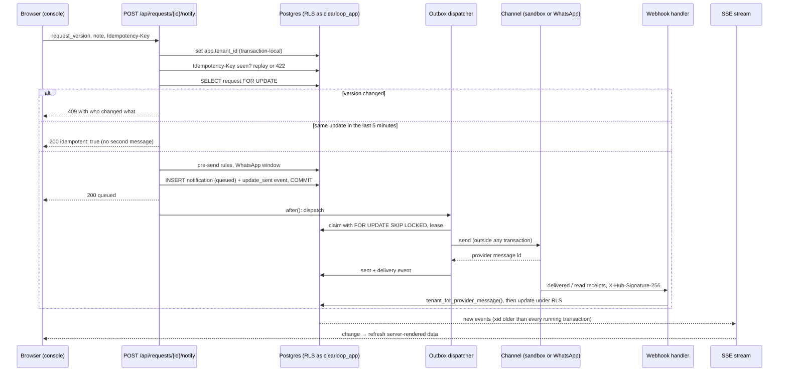
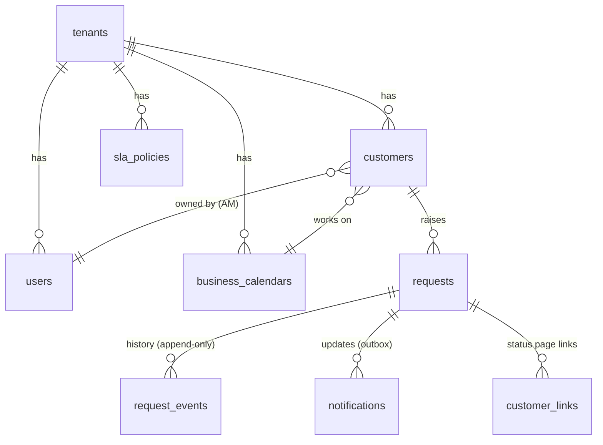

# Architecture

## What is built and what is designed

| Piece | State |
|---|---|
| Postgres schema, forced row-level security, the app role, privileged functions | Built and tested |
| Sandbox tenants per visitor, the seed story, the virtual clock | Built and tested |
| Notify: version check, Idempotency-Key, duplicate guard, pre-send rules, WhatsApp window | Built and tested |
| Transactional outbox, retries, sandbox channel, signed receipts | Built and tested |
| WhatsApp Cloud API adapter | Built and unit-tested (template or free text, transient errors, Retry-After); not wired in, because the demo has no credentials and its customers have no real phone numbers |
| Email adapter | Designed only. It is the same interface as WhatsApp |
| Server-Sent Events with a read barrier, presence | Built and tested |
| Business-time SLA engine (`packages/business-time`) | Built and property-tested |
| Update debt, ask-first rate, time-to-tell | Built and tested |
| Customer status page by signed link | Built and tested |
| Real authentication | Designed only (decision 0001); a signed sandbox cookie stands in |

## Layout

```
apps/web/                 Next.js 16 (App Router): pages, route handlers, the console
  lib/domain/             Pure logic: debt, metrics, SLA, templates, the WhatsApp window, pre-send rules, redaction
  lib/server/             Server-only: session, notify, outbox, webhooks, read model, seed, sandbox
  lib/api/contracts.ts    The API in Zod; the routes parse with it and OpenAPI is generated from it
  i18n/                   Typed Arabic and English dictionaries
packages/db/              Migrations (SQL), the Drizzle mirror, withTenant, test harness
packages/business-time/   Business-hours engine with GCC and Egypt calendars
scripts/                  dev, migrate, check-bundle, check-workflows, guard-checks
```

## One request, end to end: an account manager tells a customer



## Data model



Every table carries `tenant_id`, and every reference above is a composite `(tenant_id, id)` foreign key ([decision 0003](decisions/0003-child-tables-carry-the-tenant-and-references-are-composite.md)).

Compared with v1's six entities:
- `StatusEvent` became `request_events`, which also records notes, ETA changes, customer pings, sent updates and delivery receipts, each marked internal or customer-visible.
- Teams stayed a column, because nothing in the product needs more.

## Time

All time comes from one clock: real time plus the sandbox's offset, which the time machine moves forward only. Events record virtual time (`occurred_at`). Leases, rate limits and idempotency windows use real time, because they are about the network, not the story.

## Risks

- **At-least-once delivery.** A crash between a provider accepting a message and the result being recorded repeats the message once ([decision 0006](decisions/0006-deliveries-go-through-a-transactional-outbox.md)).
- **Polling cost.** Each open console runs one small query every 1.5 seconds. A managed pub/sub is the swap if traffic grows ([decision 0007](decisions/0007-live-updates-use-server-sent-events-with-a-read-barrier.md)).
- **Holiday data.** Hijri holidays are computed from Umm al-Qura and can be a day off official announcements. Tenants override them.
- **Sandbox growth.** Expired sandboxes need the purge to run. On the Hobby plan it runs daily.
