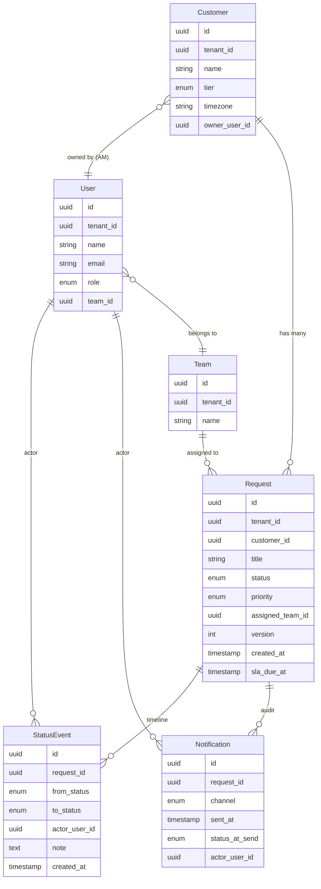

# Part 2 — Technical Design

## Data model

Six entities. Four root entities carry `tenant_id` explicitly; the two child entities (`StatusEvent`, `Notification`) inherit tenant scope transitively through `request_id`.

### Diagram



### Entity-by-entity

- **`User`** — `id, tenant_id, name, email, role (am | engineer | lead | admin), team_id`. The actor for status events and notifications.
- **`Team`** — `id, tenant_id, name`. Users belong to a team; requests are assigned to a team.
- **`Customer`** — `id, tenant_id, name, tier, timezone, owner_user_id`. `owner_user_id` is the account manager responsible (FK to `User` where `role = am`). `tier` (`standard | pro | vip`) sets the default SLA window.
- **`Request`** — `id, tenant_id, customer_id, title, status (new | triage | in_progress | blocked | resolved), priority, assigned_team_id, version, created_at, sla_due_at`. One customer has many requests. `version` increments on every status change and powers stale-state protection in the notify endpoint (see API section).
- **`StatusEvent`** — `id, request_id, from_status, to_status, actor_user_id, note, created_at`. Renders as the timeline inside the request drawer. Tenant scope inherited via `request_id`.
- **`Notification`** — `id, request_id, channel (whatsapp | email), sent_at, status_at_send, actor_user_id`. Audit trail and the idempotency-key source for duplicate-send protection. Tenant scope inherited via `request_id`.

### Tenant scoping

`tenant_id` lives on the four root entities (`User`, `Team`, `Customer`, `Request`). Every query is filtered by `tenant_id` derived from the authenticated session, **never accepted from the client**. This is what makes the cross-tenant edge case below enforceable rather than aspirational — the scoping happens at the data-access layer, not at the HTTP layer where a route handler could forget to pass it.

### Note on the prototype

The prototype's static dataset flattens `User` and `Team` into name strings on `Request` and `StatusEvent` rows for rendering simplicity. The full relational model is documented here because Part 2 is judged on technical thinking, not on prototype mirroring; the join model would apply in a real backend.

---

## Two API endpoints

### 1. List requests for the authenticated AM

```
GET /api/requests?owner=me&status=open&sla=at_risk&page=1
```

**Request — query params only.**

| Param | Values | Meaning |
| --- | --- | --- |
| `owner` | `me` (default), `all` | `me` filters to `customer.owner_user_id = session.user_id`. `all` returns the whole tenant — gated by `role IN (lead, admin)`. |
| `status` | `open` (default), `all` | `open` excludes `resolved`. |
| `sla` | `any` (default), `at_risk`, `breached` | `at_risk` = `hours_to_sla <= 4`. `breached` = `hours_to_sla <= 0`. |
| `page` | integer | Pagination cursor. |

`tenant_id` and `user_id` are derived from the authenticated session — never trusted from the client.

**Response 200.**

```json
{
  "items": [
    {
      "id": "req_01",
      "customer": { "id": "cus_01", "name": "Nour Logistics", "tier": "vip" },
      "title": "Driver app crash on cold start",
      "status": "in_progress",
      "priority": "high",
      "version": 4,
      "sla_due_at": "2026-05-22T14:00:00+04:00",
      "hours_to_sla": 3.2,
      "assigned_team": "Mobile",
      "last_notified_at": "2026-05-21T09:12:00+04:00"
    }
  ],
  "total": 14,
  "page": 1,
  "page_size": 20
}
```

### 2. Push a status update to the customer

```
POST /api/requests/{id}/notify
```

**Request.**

```json
{
  "channel": "whatsapp",
  "template": "status_update",
  "request_version": 4,
  "custom_note": "We've identified the root cause and have a fix in QA."
}
```

`request_version` is the version the AM saw when they opened the drawer. The server compares it against the current `Request.version`; if mismatched, the server returns 409 (see below).

**Response 200 — sent (or collapsed by idempotency).**

```json
{
  "notification_id": "ntf_42",
  "sent_at": "2026-05-21T13:58:11+04:00",
  "channel": "whatsapp",
  "status_at_send": "in_progress",
  "idempotent": false
}
```

`idempotent: true` indicates a duplicate within the 5-minute window — the original notification record is returned, no second message is sent to the customer.

**Response 409 — stale request.**

```json
{
  "error": "stale_request",
  "current": {
    "id": "req_01",
    "status": "blocked",
    "version": 5,
    "sla_due_at": "2026-05-22T14:00:00+04:00",
    "last_status_change_at": "2026-05-21T13:55:00+04:00"
  }
}
```

The client must reload the drawer with the current snapshot and ask the AM to reconfirm before retrying. This is the difference between sending an out-of-date update and an unintentionally misleading one.

---

## Two edge cases that must be handled before launch

### Edge case 1 — Cross-tenant / wrong-account visibility

**The risk.** A bug in the request-list query that doesn't scope by tenant could leak another company's requests to an AM. A bug that scopes by tenant but not by user could leak another AM's customers inside the same tenant. Either is a data-breach-class incident in B2B SaaS — the kind that ends customer relationships and triggers regulatory questions in the GCC.

**How to handle it.**

- Scope every query at the data-access layer by `tenant_id` pulled from the session middleware. The HTTP layer never passes `tenant_id` down; the data layer reads it from a session-scoped context object so a route handler *cannot* forget to include it.
- For `owner=me`, the data layer additionally filters by `customer.owner_user_id = session.user_id`. The `owner=all` path is gated by role (`lead | admin`).
- **Integration test that runs in CI:** authenticate as AM-A from Tenant A, request `GET /api/requests/{customer_id_in_tenant_b}`. Assert the response is `404 Not Found`, *not* `200 []`. The distinction matters — `200 []` would let an attacker enumerate which IDs exist across tenants by timing or response-shape differences.

### Edge case 2 — Duplicate or stale notifications under concurrent action

**The risk.** Two AMs hit Notify on the same request within the same minute → the customer receives two WhatsApp messages saying the same thing. Or one AM opens the drawer, walks away, comes back 10 minutes later when the request status has changed (engineer marked it `blocked` because they need customer input), and sends a "we're working on it" update — the customer now has misleading information attributed to a named person on the team.

**How to handle it.**

- The client sends `request_version` (the version the drawer was rendered against) in `POST /notify`. The server compares it against the current `Request.version`. If mismatched, return 409 with the fresh snapshot — the AM has to reload and reconfirm.
- If versions match, apply a 5-minute idempotency window keyed on `(request_id, status_at_send, channel)`. Inside the window, a second `POST /notify` returns the *original* notification record with `idempotent: true` and performs no second send to the customer.
- The `Notification` table itself is the source of truth for the idempotency check — no separate cache. This means the protection survives server restarts and works in horizontally-scaled deployments without extra infrastructure.

---

## What is intentionally out of scope of this document

- **Timezone-aware SLA modelling.** Compute `sla_due_at_utc` once at request creation from the customer's tenant timezone and business calendar, then format to local at display. Real concern, but second-priority — flagged in `NOTES.md` rather than treated as a launch blocker.
- **Authentication / session protocol.** Assumed to exist (the platform already manages customers and requests); this document treats `session.user_id` and `session.tenant_id` as primitives.
- **Real notification-channel delivery (WhatsApp BSP, email provider, retries, bounces).** Described as scope in `NOTES.md`; the prototype mocks the channel with a toast + a persisted notification row.
