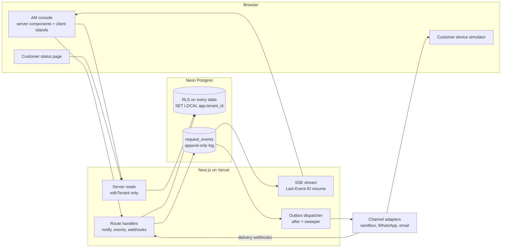

# ClearLoop v2 plan

Status: approved with its defaults and built on 2026-11-19. Kept as written, as the spec v2 was built from. What changed during the build is in [`case-study.md`](case-study.md), [`v2-build-log.md`](v2-build-log.md) and [`decisions/`](decisions/).
This was the spec for v2, in the same role `TAKEHOME_KICKOFF.md` played for v1.

## Summary

ClearLoop started as a 3.5-hour take-home. v2 turns it into a flagship product repo. It keeps the best part of v1, which is the judgment in the docs.

v2 makes three moves:

1. **Make every v1 promise executable.** The design doc promised tenant isolation, a 409 on stale state, and idempotent notify. v2 builds each one. Each one gets a test, and the test is shown to fail when its guard is removed.
2. **Build what v1 pointed at but never built.** The core signal becomes *update debt*: the gap between what the customer knows and what is true. v1's riskiest assumption becomes the north-star metric, the *ask-first rate*. SLAs run on business time with GCC calendars. The loop becomes visible end to end, from send to read receipt.
3. **Present it as a product.** That means:
   - a new design language;
   - Arabic and English with RTL;
   - a live demo where every visitor gets an isolated tenant;
   - a README that opens on a GIF;
   - a case study that tells the take-home-to-product story honestly, including what v1 got wrong.

Tagline: *Your customer should never have to ask "any update?"*

---

## 1. Where v1 stands

### Keep

- **The thinking.** This covers the AM as the primary user, the root cause, the riskiest assumption, and the list of things not to build. v2 builds on these instead of replacing them.
- **The stack.** Next.js 16, React 19, Tailwind 4, and shadcn/ui. Typecheck and lint pass clean.
- **The habit of declaring the cut line before building.** See section 10.

### Fix

Each item was checked against the code or the live site on 2026-11-19.

| # | Issue | Evidence |
|---|---|---|
| 1 | **Tenant B's data ships to every visitor.** `app/page.tsx` is a client component that imports `lib/data.ts`. The whole dataset reaches the browser, and the tenant filter runs there. `part2-technical.md` says the design prevents exactly this. | The live client chunk `0kk95ct_6gd_4.js` contains "Shift scheduling collision in night shift", a Tenant B request. |
| 2 | **Two clocks.** SLA math uses a fixed `NOW_ISO` of 21 May. Relative times and the "Today" label use the real clock. | The live HTML was prerendered at build time and says "Today · Thursday 21 May". Rendered in a browser today, one row reads "Notified 183d ago" next to "At risk · 3.0h left". On the live site the text also changes during hydration. |
| 3 | **The two edge cases in part2 are not implemented.** The notify route ignores `request_version`. It always returns `idempotent: false`. | `app/api/requests/[id]/notify/route.ts` |
| 4 | **Notify increases `version`.** The design increases it on status changes only. Once 409 checks are on, a second notify would conflict with itself. | `handleNotified` in `app/page.tsx` |
| 5 | **"Persisted server-side" is a `Map` inside one serverless instance.** It resets on cold start, and nothing reads it back. Its GET handler returns any request's log with no tenant check. | `route.ts` |
| 6 | **There is no dark mode.** The build log says dark mode renders correctly. But nothing applies the `.dark` class (`next-themes` is installed but unused), and components hardcode `bg-white`. | `layout.tsx`, components |
| 7 | **Low density.** At 1440x900, 3 of 10 requests are fully visible above the fold. Each row is 114 px tall, and the list starts 431 px down. | Measured in the browser |
| 8 | **Public-repo hygiene.** There is no LICENSE, no tests and no CI. The scaffold SVGs and the default favicon are still there. The page metadata says "take-home". The assignment PDF is committed. | Repo tree |

None of this is a criticism of a 3.5-hour build. It becomes the "what v1 got wrong" section of the case study. Fixes 1 and 2 ship first, because the live link is public today.

---

## 2. Positioning

**What it is.** ClearLoop is an update-loop console for account managers at B2B SaaS companies in the GCC. It shows what each customer knows next to what is true. It closes the gap in one keystroke.

**Its role in your portfolio.** Your eight public repos make the AI-verification case six times over. In them, the model proposes, deterministic code verifies, a human confirms side effects, and everything runs without keys. Product engineering is the thin part. As of 2026-11-19, no public repo has any of these:

- real-time multi-user work (proofsheet and raff only stream to one user);
- optimistic concurrency with a conflict UX (raff has a database race test, and FigureMatch has a row lock);
- Postgres row-level security or multi-tenancy;
- an RTL or Arabic UI, or i18n;
- Playwright, end-to-end, accessibility, or visual tests;
- an outbox or webhooks;
- a published package;
- a product-metrics view;
- a README with a screenshot or GIF.

ClearLoop v2 covers all of them in one product. It also pairs with SignalDesk. SignalDesk turns inbound client messages into tickets, and ClearLoop closes the loop back to the client.

**The stance.** In this repo, the interesting decision is what *not* to give to a model. v1 decided that the trust signal is the named human, not the text, and v2 keeps that. No model writes to customers, and the pre-send checks are deterministic. For an AI architect, showing that judgment is worth more than one more model integration.

**Origin.** The README tells the origin story in one line and links to the case study. The original submission stays inspectable at a tag.

---

## 3. What is new

### 3.1 Update debt and the ask-first rate

v1 shows one risk per request: *are we slow?* That is the SLA. The brief describes a second, independent risk: *does the customer know?* A request can be on time while the customer hears nothing. That is the CSAT problem.

- **Update debt.** This is the set of customer-visible events since the last update the customer received: status changes, customer-facing notes, and ETA changes. Debt age is the time since the oldest of them.
- **Owed updates.** This view lists every request that has debt. It ranks them by debt age, weighted by tier, with the SLA as the tiebreak. The AM works the list down to zero instead of remembering who to tell.
- **Ask-first rate.** This is the share of customer-visible changes where the customer asked before we told them. It is v1's riskiest assumption, "will AMs notify proactively?", turned into the product's north-star metric. v1 planned to measure it once by shadowing AMs. v2 measures it all the time from the event log.
- **Time-to-tell.** This is the median time from a customer-visible change to the customer being told, per AM and per tier.
- **Log an update I already sent.** This records an update that went out another way, so debt matches reality. The idea comes from the v1 NOTES.

Each row shows two signals, and they never share a color: SLA (time) and debt (communication).

### 3.2 Business-time SLAs for the GCC

v1's SLA counts wall-clock hours, the same for every customer. Real SLAs count the customer's business hours.

- **A calendar per customer.** Each calendar sets:
  - a time zone;
  - the work week: Sunday to Thursday in Saudi Arabia, Kuwait, Qatar, Bahrain, Oman and Egypt, and Monday to Friday in the UAE since 2022;
  - working hours;
  - public holidays, stored as data, with per-tenant overrides;
  - Ramadan hours, derived from the Umm al-Qura calendar (`Intl` supports it as `islamic-umalqura`).

  Every date can be overridden, because official dates follow announcements.
- **`waiting_on_customer` pauses the clock.** v1's own data shows why this matters. `req_02` says "Need sample export from customer to reproduce" and shows "Breached · 6h over". In v2 its clock is paused. The AM's action also changes from "send an update" to "ask the customer for the export", which uses a different template.
- **`packages/business-time`.** The engine is pure TypeScript with no framework. Property tests with fast-check prove that:
  - a due time never falls outside working time;
  - adding `a` and then `b` equals adding `a + b`;
  - the business duration from `t` to `add(t, h)` is `h`;
  - pausing never makes a due time earlier;
  - results stay correct across Cairo's daylight-saving changes.
- **Time machine.** In the demo, you can jump to Thursday 16:30 in Riyadh and watch the countdowns stop for the weekend.
- **Stretch goal: publish the engine to npm.** Business-hours libraries assume a Saturday-Sunday weekend and Western holidays.

### 3.3 The loop, visible end to end

v1 ends at a toast. The loop is only closed when the customer has seen the update.

- **Delivery states on every update.** These are queued, sent, delivered, read, or failed with a retry. The AM sees "read 2m ago".
- **A customer device simulator beside the console.** It acts as the sandbox channel:
  - messages arrive on it;
  - reading a message sends a read receipt back;
  - replying "any update?" records an inbound ping, which feeds the ask-first rate.

  It uses a neutral messaging UI, not a copy of any messenger's branding.
- **A composer that follows WhatsApp's rules.** A business can send free text only within 24 hours of the customer's last message. Outside that window it must use pre-approved templates. ClearLoop tracks each customer's window and switches between free text and templates. Templates exist in Arabic and English, and the default is the customer's preferred language.
- **Real adapters behind one interface.** There is one for the WhatsApp Cloud API and one for email. The webhook verifies `X-Hub-Signature-256`. The public deployment has no channel credentials at all, so the demo cannot send a real message.
- **A customer status page reached by magic link.** The link is signed, expiring and revocable. The page is bilingual. It shows only customer-visible events, because every event now carries `visibility: internal | customer`. The page ships behind a per-tenant flag that is off by default. v1's NOTES made the portal depend on customer validation, and shipping it as a flagged experiment keeps that decision.

### 3.4 Concurrency you can watch

- **Stale-state protection.** `version` increases on status changes only, and notify sends the version the AM saw. If that version no longer matches, the API returns 409 with a fresh snapshot. The drawer then shows *what changed since you opened this* before the AM can resend. raff shows that the database wins a race. ClearLoop shows the user what happened when they lose one.
- **Idempotency.** An `Idempotency-Key` header is scoped to the tenant and the purpose and tied to a fingerprint of the body. Together with a unique constraint, it means a double-click, or two AMs inside the window, sends one customer message. The duplicate call returns the original record with `idempotent: true`. Reusing the same key with a different body is rejected with 422.
- **Live updates.** They stream over Server-Sent Events from the event log and resume with `Last-Event-ID`. Presence shows who else has the request open.
- **One clock.** All time comes from one injectable clock. Each sandbox has a clock offset, so the demo always opens on a weekday morning in Riyadh. The time machine only moves that offset, so v1's two-clock bug cannot come back.
- **Demo.** Open two windows. A Playwright test with two browser contexts does the same thing in CI.

### 3.5 Arabic and English, built in

- **Both languages everywhere.** The console, the messages and the status page all work in Arabic and English. RTL comes from logical CSS properties from the first component, because adding it later is the expensive path. Numbers and dates follow the locale, and Hijri dates are optional.
- **Typed dictionaries from your ToolKit (`react-web-kit/i18n`), adapted for server components.** A missing Arabic string fails `tsc`. Translation is therefore enforced on every string as it is written, not in a final pass. `<html lang dir>` is set on the server, so the page never flashes left-to-right first.
- **One type family drawn for both scripts.** For example, IBM Plex Sans with IBM Plex Sans Arabic and Plex Mono.
- **Playwright screenshots in both directions.**

### 3.6 Keyboard-first triage

| Key | Action |
|---|---|
| `j` / `k` | Move through the list |
| `Enter` | Open the request |
| `n` | Notify the customer |
| `l` | Log an update sent another way |
| `/` | Search |
| `Ctrl+K` | Command palette |
| `?` | Shortcut list |

There are also saved views, and a bulk "notify all owed" action that previews each message. v1's NOTES listed this as the next hour of work, because AMs triage many requests in a row.

### 3.7 Pre-send checks, with no model

Before a message goes out, deterministic checks look for:

- text copied from an internal-only note (the only check that blocks the send);
- an engineer's name;
- a time promise ("today", "by Thursday", "اليوم") when the request has no ETA;
- a status claim that contradicts the current status;
- Arabic and English versions that disagree on numbers or dates.

Every check except the first is a warning. A labelled set of cases runs in CI, including hostile internal notes.

**Optional LLM layer (decision 2).** A model could add the checks rules do badly:
- formal versus colloquial Arabic;
- over-promising;
- clarity.

If it ships, it follows your usual rules: a mock model so CI needs no key, versioned prompts, golden cases, and no spending in CI. It never writes the message.

---

## 4. The 60-second demo

This script drives the design, the README GIF and the video.

1. Click **Open the live demo**. You get your own sandbox tenant.
2. The rail shows **Owed updates · 4**. The top row is Nour Logistics, a VIP customer. The SLA is fine, but the customer is two updates behind. That is the brief's problem, now visible.
3. Press `n`. The preview is in Arabic, because this customer prefers Arabic. Send it. The device simulator receives the message, the read receipt comes back, the loop icon closes, and debt drops to zero.
4. Open a second window as another AM. In it, move a request to *Waiting on customer* while the first window has that request open. The first window shows a "changed" banner. Its notify returns 409 with a diff. Resend.
5. Use the time machine to go to Thursday 16:30 Riyadh time, then into the weekend. The countdowns stop.
6. Open **Insights**. The ask-first rate has moved because of what you just did.
7. Copy the customer link. The status page is bilingual and shows no internal notes.

---

## 5. Architecture



| Concern | Choice | Reason |
|---|---|---|
| Data reads | Server components, through `withTenant(session, fn)` | Tenant data never enters a client bundle. `withTenant` is the only way to get a database handle, so code that forgets the tenant does not compile. This is v1 NOTES Day 3, built. |
| Database | Neon Postgres and Drizzle | The free tier sleeps and wakes. Every preview deploy gets its own database branch. |
| Tenancy | RLS on every table with `FORCE ROW LEVEL SECURITY`. The app connects as a role that does not own the tables. | The database enforces isolation, so nobody has to remember a `WHERE`. |
| Tenant column | `tenant_id` on child tables too | In v1, child tables inherited the tenant through `request_id`. RLS policies with joins are slow and easy to get wrong. This is recorded as a decision. |
| State | `request_events` is an append-only log. `requests` is a projection updated in the same transaction. | One source feeds the timeline, the live stream and every metric. |
| Realtime | SSE over the event log, paused when the tab is hidden | It works on serverless, resumes after a drop, and needs no extra vendor. It can move to managed pub/sub if traffic needs it. |
| Delivery | A transactional outbox. Messages go out at once through `after()`, and a sweeper using `FOR UPDATE SKIP LOCKED` retries with backoff. | No send is lost or duplicated after a crash. Vercel Hobby cron runs only daily, so the sweeper's trigger is recorded as a decision. |
| Contracts | Zod to OpenAPI 3.1 at `/api/openapi.json`, with a docs page | part2's endpoints become typed, browsable docs. |
| i18n | ToolKit typed dictionaries and logical CSS properties. next-intl is the fallback if adapting them for server components gets awkward. | Missing translations fail the build, and RTL works from the first component. |
| Demo tenancy | Each visitor gets a tenant cloned from a seed: signed cookie, 24-hour life, cleanup job, rate-limited creation | The demo's own isolation proves the tenancy model. A visitor only ever sees their own sandbox, so there is nothing to moderate. Sandbox status pages are `noindex`, show a demo banner, and expire with the sandbox. |
| Auth | Not in scope. A signed demo session and a persona switcher (AM, second AM, engineer) stand in. | A recorded decision explains what production would use, and why the data layer would not change. |

### Data model changes from part2

- **`Request.status` gains `waiting_on_customer`**, which pauses the clock. `blocked` now means blocked internally.
- **`StatusEvent` becomes `request_events`**, with these types: `created`, `status_changed`, `note_added` (with visibility), `eta_set`, `customer_pinged`, `update_sent` and `delivery_updated`.
- **`Notification` gains** an idempotency key, template, language, rendered body, delivery state, provider message id and attempt count.
- **`Customer` gains** a calendar, a preferred language and channel, and the time of the last inbound message (for the 24-hour window).
- **New tables:** `business_calendars`, `sla_policies` (per tenant and tier), and `customer_links` (hashed token, expiry, revocation).
- **Every table has `tenant_id`.**

---

## 6. Every claim has a test

| Claim | Proof | Guard-removal check |
|---|---|---|
| Other tenants' data never reaches the browser | CI builds the app and searches the client bundles for canary strings that exist only in another tenant. This is the regression test for v1 issue 1. | Import the seed into a client component. The test must fail. |
| Cross-tenant reads return 404, not `200 []` | Integration test on real Postgres | Disable RLS on `requests`. The test must fail. |
| Forgetting a filter cannot leak data | `SELECT *` as the app role, with no tenant set, returns no rows | Same as above |
| Every table has an RLS policy | `rls_gaps()` check in CI (ToolKit pattern) | Add a table without a policy. The build must fail. |
| The event log cannot be rewritten | A trigger rejects `UPDATE` and `DELETE` on `request_events` | Drop the trigger. The test must fail. |
| A stale notify returns 409 with a fresh snapshot | Playwright, two browser contexts | Remove the version check. The test must fail. |
| Two AMs or a double-click send one message | Concurrent requests in an integration test | Remove the unique constraint. The test must fail. |
| SLA due times never fall outside working time | fast-check property suite | |
| Internal notes never reach a customer | Unit tests on the redaction layer, and E2E on the status page | |
| Webhooks reject bad signatures | Unit tests | |
| A keyboard-only AM can finish the core flow | Playwright with no mouse | |
| Key screens have no serious accessibility violations | `@axe-core/playwright`, with the ToolKit rule set | |
| RTL renders correctly | Playwright screenshots in Arabic and English | |

The guard-removal checks follow your own practice of proving that a check can fail.

CI runs on every PR, in this order:
1. Typecheck and lint.
2. Unit and property tests.
3. Integration tests on a Postgres service container.
4. Build and bundle canary.
5. E2E tests against the build.

Every PR also gets a preview deploy with its own Neon branch. The demo and CI need no API keys.

Two traps to avoid:

- **The test database must not use a superuser.** The default CI Postgres user is a superuser, and superusers skip RLS. The isolation tests would pass without proving anything. Tests connect as a `NOSUPERUSER NOBYPASSRLS` role.
- **The workflows get checked too.** Your ToolKit `ci_workflow` checker enforces pinned actions, least permissions, a timeout on every job, and no `pull_request_target`. Vercel's Git integration does the deploys, so CI never holds secrets.

---

## 7. Design facelift

- **The loop as the motif.** An open loop means the customer is behind, and a closed loop means they are up to date. The logo, the row indicator and the notify animation use the same shape, so the product's name means something on screen.
- **An app shell** with three parts:
  - a left rail with counted views: Owed updates, Breaching today, Waiting on customer, All open, Resolved, and Insights;
  - a dense list you can drive with the keyboard;
  - a detail pane that stays open on desktop and becomes a sheet on mobile.

  This fixes the 3-of-10 density problem.
- **Color.** Keep the teal for continuity, inside a full token set: light and dark themes, SLA states, and a separate hue for debt.
- **Type.** One family for Latin and Arabic.
- **Motion.** Small and meaningful, and it respects `prefers-reduced-motion`.
- **A landing page at `/`.** It has a one-line pitch, the loop animation, an **Open the live demo** button, the claims table, and a link to the origin story. The console lives at `/app`.
- **A four-step tour on first visit.** The time machine and the persona switcher sit in a demo dock that can be collapsed.
- **Assets.** An SVG logo and wordmark, a favicon set, an OG image built with `next/og`, and the README GIF.

---

## 8. Repository

```
/
├── README.md                ← product README, 2-minute read
├── apps/web/                ← Next.js app (was /prototype)
├── packages/business-time/  ← SLA engine, no framework, publishable
├── packages/db/             ← Drizzle schema, migrations, RLS policies, seed generator
├── docs/
│   ├── case-study.md        ← take-home to product, including what v1 got wrong
│   ├── architecture.md
│   ├── decisions/           ← NNNN-sentence-title.md, with Status, Decided and Written dates
│   ├── demo-script.md
│   └── origin/              ← the original submission, unedited
├── .claude/                 ← agentic-methodology harness
├── .github/workflows/
└── LICENSE  SECURITY.md  CHANGELOG.md
```

- **Tag first.** Put `v0.1.0-takehome` on `b48ee77`, since all four commits landed within one hour on 21 May. The v1.0.0 release notes link to the tag, so anyone can compare the 3.5-hour version with v2.
- **Remove the assignment PDF from the tree**, and summarize the problem in `docs/origin/README.md`. The PDF has no company name, and the brief allowed public repos, so also removing it from history is optional (decision 3).
- **Write the README in your current format.** In order:
  1. the name and one plain paragraph, with your byline;
  2. the live demo link and the GIF, right under the intro;
  3. how to run it with no keys;
  4. what it does;
  5. how it works, with one Mermaid diagram;
  6. engineering notes built around one real failure (Tenant B in the bundle);
  7. the claims table;
  8. reference tables;
  9. limits;
  10. roadmap;
  11. licence.

  Use short sentences and dated numbers, with no em-dashes.

---

## 9. Your toolkit and existing repos

**The rule: take patterns and small pieces, never whole projects.** ToolKit is mostly Python, and ClearLoop stays a TypeScript-only repo. So Python pieces are ported as rules and SQL, and never copied in as code.

| ToolKit piece | What it gives ClearLoop | Phase | How |
|---|---|---|---|
| `react-web-kit/i18n` | Typed ar/en dictionaries (a missing key fails `tsc`), Arabic plural forms, Latin digits, and a `dictionaryProblems()` test | 1 | Copy the piece, adapt it for server components, and render `<html lang dir>` on the server. |
| `react-web-kit/axe_checks` + `web_unit_tests` | One axe rule set for Vitest browser mode and Playwright, plus tests that fail on unstubbed requests | 1, 7 | Copy the config, and reuse the rule set through `@axe-core/playwright`. |
| `postgres-data-layer/tenant_rls` + `tenant_scoping` | The policy shape `NULLIF(current_setting('app.tenant_id', true), '')::uuid`, pool-safe `set_config(…, true)` per transaction, a non-owner app role, the `rls_gaps()` check, and 404 instead of 403 | 2 | Port the SQL into Drizzle migrations, and write `withTenant` in TypeScript. |
| `postgres-data-layer/audit_log` | An append-only `request_events` table, enforced by triggers | 2 | Port the trigger SQL. |
| `postgres-data-layer/idempotent_seed` + `synthetic_data` | Sandbox seeds that come out the same every time | 2 | Port the rules. |
| `fastapi-foundation/rate_limits` | Limits counted in Postgres, with no Redis, for sandbox creation and notify | 2 | Port. |
| `fastapi-foundation/idempotent_writes` + `error_envelope` | The idempotency rules (scope, body fingerprint, 422 on a reused key), `If-Match` with `FOR UPDATE` returning 409, and one error format for every route | 3 | Port the rules to TypeScript. |
| `react-web-kit/fetch_layer` + `ux_hooks` | A typed `ApiError`, the `readEventStream()` SSE reader, and an undo window | 3 | Copy these pieces only. Skip `async_states`, which brings a second shadcn layer, and anything that needs React Router. |
| `classified_retry`, `walled_http_call`, `fan_out_jobs` | Outbox rules: retry only transient errors, honor `Retry-After`, plus leases, backoff with jitter, and per-tenant caps | 4 | Port the rules, and run claim and execute from the sweeper. |
| `security-hardening/signed_links` | Magic links for the customer status page | 7 | Port. |
| LLM pieces: `mock_model`, `golden_tests`, `versioned_prompts`, the paid-run guard, and `injection_sanitizer` (ar/en) | Only if the LLM layer ships: CI with no API key, a test that fails when a prompt changes without a version bump, golden cases, and no spending in CI | 8 | Port the rules to TypeScript. |
| `delivery-tooling/ci_workflow` checker | Hardened GitHub Actions (see section 6) | 0 | Run it against `.github/workflows` in CI. |
| `docs_kit` | Templates for the README (2-minute run, 1-minute check, reading order, choices and their costs), the architecture doc, decisions, and a runbook | 9 | Copy the templates into `docs/`. |

**Harness.** Install your public `agentic-methodology` in Phase 0 with its installer, as the build harness. Its hooks block committed secrets and weakened tests, and using it here shows the method working on a TypeScript repo. Use it instead of Warsha's `.claude` folder, which runs Warsha's own product checks.

**Not used:**
- `reference-agent`, because it is a whole app;
- the uv and Docker delivery templates;
- the full `react-web-kit` folder, which brings a second shadcn layer and React Router;
- any Python folder as code.

Warsha serves only as a reference for worked bilingual examples.

**Version note.** `react-web-kit` was tested on React 19.3 and TypeScript 6. ClearLoop uses React 19.2.4 and TypeScript 5, so Phase 0 upgrades ClearLoop first.

**Built new.** ToolKit has nothing for:
- Next.js or Vercel;
- server-component data boundaries;
- Playwright;
- an outbox;
- webhook signatures;
- business calendars;
- demo assets.

RLS, idempotency and i18n are patterns you already have. The new work there is porting them to TypeScript on serverless and making them visible in a live demo.

---

## 10. Roadmap

Sizes are rough, and assume focused days with Claude Code. S is about half a day, M is 1 to 2 days, and L is 2 to 3 days.

| Phase | Size | Scope | Done when |
|---|---|---|---|
| 0. Hotfix and groundwork | S | Tag v0. Move data reads to the server and use one clock, which fixes issues 1 and 2 on the live site. Upgrade React and TypeScript. Set up the workspace layout, LICENSE, harness, and a CI skeleton with the workflow checker. | The live bundle has no Tenant B data, and CI is green. |
| 1. Design system and shell | M | Tokens, dark mode, type, app shell, typed dictionaries, logical properties, and a landing page skeleton. Still on static data. | The new design is live, and switching to Arabic mirrors the layout. |
| 2. Real backend and tenancy | L | Neon, Drizzle schema v2 with the append-only event log, RLS, `withTenant`, the seed generator, a sandbox per visitor, list and detail APIs, and OpenAPI | The first five rows of section 6 pass in CI, with their guard-removal checks. |
| 3. Concurrency | M | Version and 409, idempotency, SSE, presence, and the "what changed" diff | The two-window demo works on a preview deploy, and the Playwright test passes. |
| 4. The visible loop | L | Composer with templates and the 24-hour window, pre-send checks, outbox, sandbox channel, delivery states, device simulator, and webhook verification | A message goes from send to read receipt in the demo, and the webhook tests pass. |
| 5. Update debt and insights | M | Debt engine, Owed updates view, ask-first rate, time-to-tell, `waiting_on_customer`, logging an update sent another way, keyboard triage, and the command palette | Metrics come from the event log, and the keyboard-only test passes. |
| 6. Business time | M | `packages/business-time`, calendars for the GCC and Egypt, Ramadan and holiday rules, pausing, and the time machine | The property suite passes, and SLA badges use business time. |
| 7. Customer status page and accessibility | M | The flagged status page with signed links, and a full accessibility pass | axe is clean, and RTL screenshots run in CI. |
| 8. Optional LLM layer | S to M | Section 3.7, only if decision 2 says so | Golden cases run in CI with the mock model. |
| 9. Story and launch | M | README, case study, decisions, GIF, 90-second video, OG image, custom domain, v1.0.0 release, portfolio page, and launch post | Section 12 is complete. |

**Three sizes to pick from (decision 1):**

- **Quick win, 2 to 3 days:** phases 0 and 1, plus a short README, case study and GIF. The live bugs are fixed and the new look is up.
- **The version to be proud of, about 2 to 3 weeks:** phases 0 to 6, plus 9.
- **Full:** everything, including phases 7 and 8.

**If time runs short, cut in this order:** the LLM layer, the status page, time-machine polish, then presence. **Never cut:** the tenancy fix, 409 and idempotency, or update debt.

---

## 11. What v2 does not build

Kept from v1, and still right:

- in-app chat;
- customer login and customer dashboards;
- AI that sends messages;
- an SLA prediction model;
- engineer and lead workflows (engineers appear only as a demo persona that changes status).

New in v2:

- **Inbound triage and ticket creation.** SignalDesk already covers the inbound side, so ClearLoop links to it instead.
- **A copilot over the product's actions.** raff already shows that pattern. Repeating it would add AI without adding anything new.
- **Real auth and SSO.** The demo session is enough to prove the data layer, and a recorded decision describes production.
- **A native mobile app.** The responsive web app covers an AM on the move.

---

## 12. Launch checklist

- **Custom domain:** for example `clearloop.eslamhamed.com`, to match `raff.eslamhamed.com`.
- **Repo settings:** a new description and topics, a social preview image, and a pin on your profile.
- **Video:** 90 seconds, following `docs/demo-script.md`.
- **Release:** v1.0.0, with notes that link to the v0 tag.
- **Portfolio:**
  - a project page on eslamhamed.com;
  - possibly a "Selected work" entry in your profile README for product engineering, since all three current entries are AI.
- **Launch post:** suggested angle *"Ask-first rate: the metric behind an 18% CSAT drop."*

---

## 13. Decisions needed

1. **Size:** quick win, the version to be proud of (recommended), or full.
2. **AI:**
   - deterministic checks only (recommended);
   - add the LLM review layer;
   - also add draft assist as v1's NOTES allowed (a draft only, never sent automatically).
3. **Assignment PDF:** remove it from the tree (recommended), also remove it from history, or keep it.
4. **Domain:** is `clearloop.eslamhamed.com` right?
5. **Hosting:** Vercel and Neon (recommended), or Supabase. Supabase gives RLS, realtime and magic links out of the box. But its free tier pauses idle projects, which is bad for a portfolio demo.
